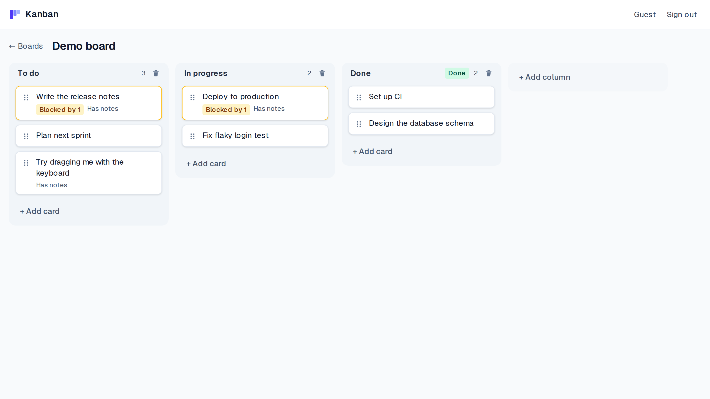
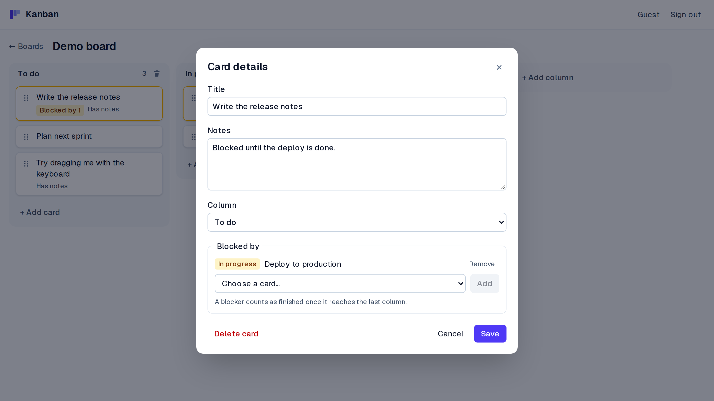
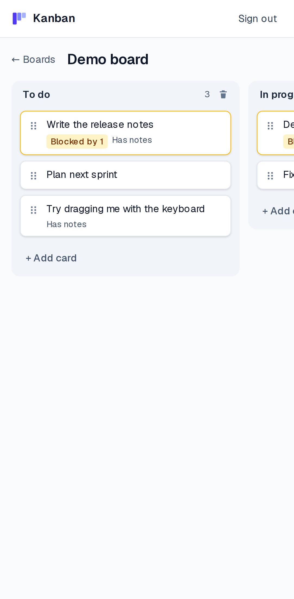
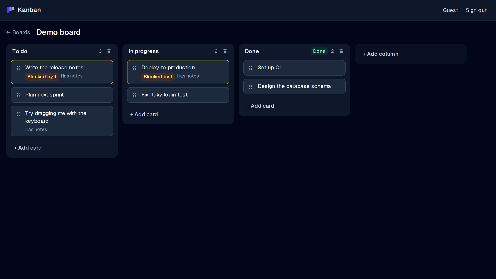

# Kanban

[](https://github.com/suforozinho/kanban/actions/workflows/ci.yml)

A multi-user Kanban board with drag and drop, GitHub sign-in and card dependencies. Built with
Next.js (App Router), TypeScript, PostgreSQL and Prisma, and tested with unit, component,
integration and end-to-end tests in CI.

**Live demo: [kanban-opal-three-93.vercel.app](https://kanban-opal-three-93.vercel.app)**. Click
**Try the demo** to get your own board without signing up.



| Card details and dependencies        | Phone layout                               | Dark mode                         |
| ------------------------------------ | ------------------------------------------ | --------------------------------- |
|  |  |  |

## Features

- **Boards, columns and cards.** Create, rename and delete all three. New boards start with To do,
  In progress and Done.
- **Drag and drop** with a mouse, a touch screen or the keyboard. Moves show instantly and are
  saved in the background.
- **Card dependencies.** Mark a card as blocked by another card. It is flagged until every blocker
  reaches the last column. Loops (A blocks B blocks A) are rejected.
- **GitHub sign-in**, and every board is private to its owner.
- **Guest demo.** One click creates a throwaway account with a ready-made board. Guests are deleted
  after 24 hours.
- **Accessible.** Keyboard drag and drop with screen reader announcements, labelled controls, and
  axe checks in the tests.
- Loading, empty and error states, a phone layout, and dark mode.

## Tech stack

| Area           | Choice                                        | Why                                                                                    |
| -------------- | --------------------------------------------- | -------------------------------------------------------------------------------------- |
| Framework      | Next.js 16, App Router, React 19              | Server Components for the first render, route handlers for the API, one deployable app |
| Language       | TypeScript (strict)                           | One language from the database to the browser                                          |
| Database       | PostgreSQL with Prisma 7                      | Relational data with real constraints; migrations are versioned in the repo            |
| Auth           | Auth.js (NextAuth v5) with GitHub             | No passwords to store; the Prisma adapter keeps users in the same database             |
| Drag and drop  | dnd-kit                                       | Supports keyboard dragging and screen reader announcements                             |
| Data fetching  | TanStack Query                                | Cache plus optimistic updates, without a global store                                  |
| Validation     | Zod                                           | Every request body is parsed before it reaches the database                            |
| Styling        | Tailwind CSS 4                                | Fast to build with; dark mode through `dark:` variants                                 |
| Tests          | Vitest, Testing Library, Playwright, axe-core | Unit, component, API-against-Postgres and browser tests                                |
| CI and hosting | GitHub Actions and Vercel                     | Every push is linted, type-checked, tested and built                                   |

## Architecture

```
Browser                         Next.js (Vercel)                            Postgres
───────                         ────────────────                            ────────
BoardView (client)  ── fetch ─▶ /api/... route handlers                    User, Account
  TanStack Query                  withUser(): session check, Zod,           Board
  optimistic updates              error → JSON status                       Column
  dnd-kit                            │                                      Card
                                     ▼                                      CardDependency
Server Components ─────────────▶ src/server/*  (data access layer) ──────▶
  first render, auth redirect     every query filtered by owner id
```

- **`src/app`** holds pages and API route handlers. Pages are Server Components. They check the
  session, load the board and pass it to the client as the query's initial data, so the first
  paint needs no extra request.
- **`src/server`** is the only code that talks to the database. Every function takes the
  signed-in user's id and includes it in the query's `where` clause.
- **`src/lib`** holds code that runs on both sides: ordering, dependency rules, validation
  schemas and types. The browser and the server use the same `planInsert` function, so an
  optimistic move and the saved move produce the same order.
- **`src/components`** holds the client UI.

### API

| Method             | Route                                    | Purpose                                       |
| ------------------ | ---------------------------------------- | --------------------------------------------- |
| GET, POST          | `/api/boards`                            | List or create boards                         |
| GET, PATCH, DELETE | `/api/boards/:boardId`                   | Read (with columns and cards), rename, delete |
| POST               | `/api/boards/:boardId/columns`           | Add a column                                  |
| PATCH, DELETE      | `/api/columns/:columnId`                 | Rename or delete a column                     |
| POST               | `/api/columns/:columnId/cards`           | Add a card                                    |
| PATCH, DELETE      | `/api/cards/:cardId`                     | Edit or delete a card                         |
| POST               | `/api/cards/:cardId/move`                | Move to `{ columnId, index }`                 |
| POST               | `/api/cards/:cardId/blockers`            | Add a blocker `{ blockerId }`                 |
| DELETE             | `/api/cards/:cardId/blockers/:blockerId` | Remove a blocker                              |

Errors come back as `{ "error": "message" }` with 400 (invalid input), 401 (signed out),
404 (missing or not yours) or 409 (would create a dependency loop).

## Decisions and trade-offs

### Restarting on the App Router

The first version was a Create Next App starter on the Pages Router, with local state only and
no back end. Moving it over would have meant rewriting nearly every file anyway, so I started
from a clean App Router scaffold. The old code is on the `legacy-pages-router` branch.

### Keeping card order correct

Each card stores a **fractional index** key (`a0`, `a0V`, `a1`…). A key can always be generated
between two others, so a move updates one row instead of renumbering the column.

- The client sends **where** the card should go (`columnId` and `index`), not a key. The server
  works out the key from the order that is actually in the database.
- The move runs in a transaction that takes a row lock on the destination column
  (`SELECT … FOR UPDATE`). Two moves into the same column at the same moment run one after the
  other, so they can't both pick the same key. An integration test drops 8 cards into one column
  at once and checks that every key is unique. The test fails when the lock is removed.
- Keys are compared by code point in application code, not with the database's text collation,
  which may not sort `A` before `a`.
- If keys are ever broken (duplicates from a bug or a manual edit), the next insert into that
  column spaces every card out again.
- **Trade-off:** the last write wins. If two people move the same card at once, the second move
  is the one that sticks. There are no live updates, so the other person sees it on their next
  refetch.

In the browser, the move is applied to the cache **synchronously** before the request goes out,
so the card never jumps back. When several moves are in flight, the board is refetched only once
the last one finishes, so an early response can't undo a later move. A failed request shows a
message and the refetch restores the real state.

### One user can't see another user's boards

- Every data access function filters by the owner id, for example
  `updateMany({ where: { id, board: { ownerId: userId } } })`. There is no code path that loads a
  row by id alone and checks the owner afterwards.
- A missing board and someone else's board both return **404**, so ids can't be probed.
- Moving a card or adding a blocker also checks that both sides are on the **same** board, so
  you can't move your card into someone else's column.
- [`src/server/ownership.int.test.ts`](src/server/ownership.int.test.ts) signs in as user A and
  sends every API route at user B's ids. Each request must return 404, and B's board must be
  unchanged afterwards. A Playwright test does the same through the UI.

### Card dependencies

- Stored in a join table (`CardDependency`) with a composite primary key, and deleted together
  with either card.
- Before saving, the server walks the existing dependencies to make sure the new one doesn't
  create a loop. It locks the board row first, so two requests at once can't create a loop
  together.
- **Trade-off:** "done" means "in the last column". That needs no extra setup, but it is implicit.
  A per-column "counts as done" setting would be more flexible.

### Sessions and the guest demo

- Sessions are JWTs in a cookie. Auth.js needs this for the guest (credentials) provider, and it
  keeps session checks off the database. The Prisma adapter still stores GitHub users and
  accounts.
- **Try the demo** creates a new guest user with a seeded board. Guests older than 24 hours are
  deleted each time a new guest is created.

## Running locally

Requirements: Node.js 24 and Docker (or any PostgreSQL 15+).

```bash
git clone https://github.com/suforozinho/kanban.git
```

```bash
cd kanban && npm install
```

```bash
cp .env.example .env
```

```bash
npx auth secret
```

The last command writes `AUTH_SECRET` to `.env.local`. You can also generate one with
`openssl rand -base64 32` and paste it into `.env`. Then start Postgres, apply the migrations and
run the app:

```bash
docker compose up -d
```

```bash
npm run db:migrate
```

```bash
npm run dev
```

Open http://localhost:3000 and click **Try the demo**. GitHub sign-in is optional locally. To
enable it, create an OAuth app at https://github.com/settings/developers with the callback URL
`http://localhost:3000/api/auth/callback/github`, then fill in `AUTH_GITHUB_ID` and
`AUTH_GITHUB_SECRET`.

### Environment variables

See [`.env.example`](.env.example).

| Variable                               | Required | Description                                                            |
| -------------------------------------- | -------- | ---------------------------------------------------------------------- |
| `DATABASE_URL`                         | Yes      | Postgres connection string                                             |
| `AUTH_SECRET`                          | Yes      | Signs and encrypts the session cookie                                  |
| `AUTH_GITHUB_ID`, `AUTH_GITHUB_SECRET` | No       | GitHub OAuth app. Without them, only the guest demo is shown           |
| `DEMO_MODE_ENABLED`                    | No       | Set to `false` to hide **Try the demo**                                |
| `AUTH_TRUST_HOST`                      | No       | Set to `true` when running `next start` outside Vercel                 |
| `TEST_DATABASE_URL`                    | No       | Database for integration tests. Defaults to `kanban_test` on localhost |

## Tests

| Command                                                     | What it runs                                                                                                            | Needs a database     |
| ----------------------------------------------------------- | ----------------------------------------------------------------------------------------------------------------------- | -------------------- |
| `npm test`                                                  | Unit tests (ordering, dependency rules, validation) and component tests (card, column, axe)                             | No                   |
| `npm run test:integration`                                  | API route handlers and data access against real Postgres: ownership, concurrent moves, dependencies, guest cleanup      | Yes (`kanban_test`)  |
| `npm run test:e2e`                                          | Playwright in Chromium: sign in, create a card, drag it, reload; keyboard drag; axe; another user's board; phone layout | Yes (`DATABASE_URL`) |
| `npm run lint`, `npm run typecheck`, `npm run format:check` | ESLint, TypeScript and Prettier                                                                                         | No                   |

`docker compose up -d` creates both the `kanban` and `kanban_test` databases. Before the first
end-to-end run, install the browser with `npx playwright install chromium`. The end-to-end tests
build the app and start it on port 3100.

CI ([`.github/workflows/ci.yml`](.github/workflows/ci.yml)) runs all of these on every push, using
a Postgres service container.

## Deploying (Vercel and Neon)

1. Create a free Postgres database on [Neon](https://neon.tech) (or Supabase) and copy its
   connection string.
2. Create a GitHub OAuth app whose callback URL is `https://<your-app>.vercel.app/api/auth/callback/github`.
3. Import the repo in Vercel and set `DATABASE_URL`, `AUTH_SECRET`, `AUTH_GITHUB_ID` and
   `AUTH_GITHUB_SECRET`.
4. Deploy. The `vercel-build` script runs `prisma migrate deploy` before `next build`, so the
   schema is always up to date.

## Project structure

```
prisma/              schema and migrations
src/app/             pages, layouts, loading/error states, API route handlers
src/components/      client UI (board, column, card, dialog, forms)
src/hooks/           TanStack Query hooks with optimistic updates
src/lib/             shared logic: ordering, dependencies, validation, types, HTTP helpers
src/server/          data access layer (the only code that queries the database)
src/auth.ts          Auth.js configuration
e2e/                 Playwright tests
test/                test setup, factories and helpers
```

## Known limitations

- No live updates. Another tab or user sees changes on the next refetch (when the window regains
  focus, or after a change of their own).
- Columns can't be reordered yet. New columns are added at the end.
- Anyone can create guest accounts. They expire after a day, but there is no rate limit.
- "Done" is always the last column.

## What I would add next

- Live updates over WebSockets or server-sent events, so several people can work on one board.
- Notifications when a card you are blocked by is finished.
- Shared boards with roles (owner, editor, viewer).
- Dragging columns to reorder them, using the same fractional index approach.
- Rate limiting for guest sign-ups.
